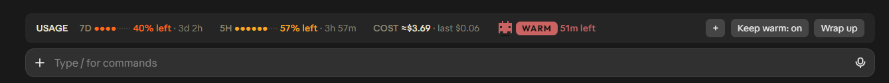

# wavebar

A band above the Claude Code prompt that shows where you stand: usage left, whether the prompt
cache is warm, how far the current request has come, which subagents are running, and what the
conversation has cost so far. A small robot surfs the progress line.

wavebar is a [Claude Code mod](https://code.claude.com/docs). It draws and listens; it never
calls a model by itself.



*The band as it sits above the prompt: usage left, what the conversation has cost, the cache
state, and the buttons. The progress line, the subagents and a held git command appear in the
same band while Claude works.*

<!-- Still to add: assets/wavebar-progress.png (the surfer on the progress line),
     assets/wavebar-card.png (cache card open) and assets/wavebar-held.png (a held git command). -->

## What it shows

| Part | What you see | Where it comes from |
|---|---|---|
| **Usage** | 7-day and 5-hour limits as dot bars, percent left and reset time; `LOW` under 15% | Claude Code's own rate-limit figures |
| **Prompt cache** | `WARM` with minutes left, or `COLD` with the idle time and what the next message costs to re-cache. `+` opens a card with the context size and the next message's price per model | A clock from the last main-thread request, one hour long |
| **Progress** | The robot surfing a line with a mark per step, plus `3/7 · Run tests` | The task list Claude already keeps, or the `progress` tool (below) |
| **Activity** | With no task list: the robot pacing, `working · 4 steps · 1m 12s` | Turn events |
| **Subagents** | One small robot per running subagent, `×2 Explore 4, sonnet-coder 12` | Subagent start, request and finish events |
| **Cost** | `COST ≈$12.40 · last $0.35`: the conversation so far and the latest turn | Token counts per finished turn at list prices |

## What it does

- **Keep warm switch.** With [cache-tax](https://github.com/karanb192/cache-tax) installed, a
  `Keep warm: on/off` button runs cache-tax's `/keepwarm always` and `/keepwarm off`. It is off
  until you press it. wavebar also listens to cache-tax's keep-warm pings, so the band says
  `WARM` for as long as the cache really is.
- **Hold for risky git commands.** When Claude runs `git reset --hard`, a `git checkout` or
  `git restore` that discards changes, a forced `git clean`, or a force push, through the Bash or
  PowerShell tool, wavebar holds the call and shows what it would lose (files, untracked paths,
  or the commits a force push would drop) with **Cancel** and **Proceed**.
- **Wrap up button** (off by default). Runs your `/debrief` command, writes the conversation's
  cost into the transcript for it to quote, and then stops keeping this conversation's cache
  warm while leaving the switch on for the next one.
- **A `progress` tool** Claude can call to report steps on a request it keeps no task list for.

## Requirements

- Claude Code 2.1.287 or later (mods load by default from that version).
- `git` on your `PATH`, for the hold.
- Optional: [cache-tax](https://github.com/karanb192/cache-tax) for the Keep warm switch, and a
  `/debrief` command or skill for the Wrap up button. Without them those buttons do not appear.

Built and used on Windows 11 in the Claude desktop app with a dark theme. See
[Limitations](#limitations) for what that means elsewhere.

## Install

```
/plugin marketplace add spaldinga/wavebar
/plugin install wavebar@wavebar
```

Then run `/reload-plugins`, or restart Claude Code.

From a local clone:

```bash
git clone https://github.com/spaldinga/wavebar.git
claude plugin marketplace add ./wavebar
claude plugin install wavebar@wavebar --scope user
```

If you have the original `ribbon` mod installed, uninstall it first: both draw the same band.

Remove it with `/plugin uninstall wavebar@wavebar`.

## Settings

```
/wavebar status        show the settings
/wavebar wrapup on     show the Wrap up button (default: off)
/wavebar hold off      stop holding risky git commands (default: on)
```

The Keep warm switch is the button in the band. Settings are saved for every session.

## How it works

- **No model calls.** Everything is read from events Claude Code already raises: rate limits,
  turn and subagent events, tool calls. The exceptions are yours to trigger: the Keep warm switch
  (cache-tax's pings cost tokens) and Wrap up (runs your debrief).
- **Progress without tokens.** The bar follows the task-list tool calls Claude makes
  (`TodoWrite`, the Task tools, the desktop app's plan). A step in progress counts as half, so
  the robot stands between two marks while working and on a mark when a step lands.
- **Cost is an estimate, not a bill.** Each finished turn's tokens are priced from a built-in
  list-price table (input, output, cache reads, cache writes at the 1-hour rate) and kept per
  session, so the total survives a restart.
- **The hold reads the command's text and asks only git.** Every measurement is a git command
  with paths passed as arguments, never through a shell. Cancel, no answer in ten minutes, or an
  interrupted turn refuse the command and tell Claude why. If the hold itself fails, the command
  runs as usual with a note in the transcript: it is a second look, not a lock.

## Limitations

- **Dark themes only, for now.** The band has no background of its own and its text colours are
  light, so it is hard to read on a light theme.
- **The hold is not a permission system.** It does not see commands inside `bash -c "..."`,
  scripts or aliases, and it only knows the git commands listed above. Use
  [permission rules](https://code.claude.com/docs/en/settings) for a hard block.
- **The cache state is a clock, not a server check.** It assumes a one-hour cache lifetime.
- **Prices are a table in the code** (`hooks/cache-art.ts`) and go stale when list prices change.
  A model the table does not know adds nothing to the cost.
- **Only one mod can draw the band.** wavebar takes the whole band above the prompt, so another
  mod that draws there will not show.
- **The `progress` tool is always listed**, which adds its short description to every request.
- **On managed (Team/Enterprise) installs**, some session events never reach user-installed mods.
  wavebar is built around that, but a resumed conversation shows no cache state until its first
  reply.
- Tested by its own test suite and by daily use on one Windows machine. The terminal layout and
  macOS/Linux are covered by tests only.

## Develop

```bash
claude plugin test .       # the test suite; no login needed
claude plugin validate .   # manifest and hook checks
claude --plugin-dir .      # try it for one session
```

```
hooks/
  register.tsx       hooks and the band
  cache-art.ts       colours, prices, the cache card and the robot
  progress.ts        task list and report tracking (pure)
  progress-art.ts    the progress line and the surfer
  guard.ts           risky git commands: classify and measure
  font.ts            Outfit, embedded so the drawings render anywhere
tests/               one file per area
types/index.d.ts     the mod's state
```

`AGENTS.md` has the working notes for coding agents.

## Credits

wavebar is a fork of [ribbon](https://github.com/robonuggets/ribbon) by Jay E (RoboNuggets),
which provides the usage bars, the cache card and Robo, the robot. Ideas and behaviour also come
from:

- [cache-tax](https://github.com/karanb192/cache-tax) by Karan Bansal: keep-warm, which wavebar
  drives but does not include.
- [savvy-progress](https://github.com/JohnnyVizz/claude-kit/tree/main/plugins/savvy-progress) by
  JohnnyVizz: the idea of a progress bar and a subagent display above the prompt.
- [Blast Radius](https://github.com/anthropics/claude-code-playground/tree/main/claude-code/mods/blast-radius)
  by Anthropic: holding a risky command and showing what it would change. wavebar's git
  measurements follow it.

## License

MIT, see [LICENSE](LICENSE). Copyright (c) 2026 Jay E | RoboNuggets for the original ribbon;
changes in this fork are under the same licence.

Third-party material:

| What | From | Licence |
|---|---|---|
| The band, usage bars, cache card, Robo and their tests | [ribbon](https://github.com/robonuggets/ribbon), Copyright (c) 2026 Jay E \| RoboNuggets | MIT, in [LICENSE](LICENSE) |
| Parts of `hooks/guard.ts`: how risky git commands are measured and reported | [Blast Radius](https://github.com/anthropics/claude-code-playground/tree/main/claude-code/mods/blast-radius), Copyright 2026 Anthropic PBC | Apache-2.0, in [LICENSES/Apache-2.0.txt](LICENSES/Apache-2.0.txt); the changes are listed at the top of the file |
| The rule for "a ping kept the cache warm" in `hooks/register.tsx` | [cache-tax](https://github.com/karanb192/cache-tax), Copyright (c) 2026 Karan Bansal | MIT |
| The embedded font | [Outfit](https://github.com/Outfitio/Outfit-Fonts) | SIL Open Font License 1.1 |

[savvy-progress](https://github.com/JohnnyVizz/claude-kit/tree/main/plugins/savvy-progress)
(MIT, Copyright (c) 2026 johnnyvizz) inspired the progress bar and the subagent display; no code
from it is included.

Not affiliated with Anthropic or with the projects credited above.
